# StreamFlix Content Analytics Project

End-to-end analytics project on a video streaming platform dataset: data cleaning, exploratory analysis, business KPIs, a 5-page interactive Power BI dashboard, and a management report, built to answer management's questions on viewing, content performance, subscribers, viewer experience, and catalogue investment.


---

## Table of Contents

1. [Project Overview](#1-project-overview)
2. [Objectives](#2-objectives)
3. [Business Questions](#3-business-questions)
4. [Dataset](#4-dataset)
5. [Tools and Technologies](#5-tools-and-technologies)
6. [Workflow and Methodology](#6-workflow-and-methodology)
7. [Data Cleaning and Preprocessing](#7-data-cleaning-and-preprocessing)
8. [Exploratory Data Analysis](#8-exploratory-data-analysis)
9. [Key Performance Indicators](#9-key-performance-indicators)
10. [Power BI Dashboard](#10-power-bi-dashboard)
11. [Key Findings](#11-key-findings)
12. [Business Recommendations](#12-business-recommendations)
13. [Repository Structure](#13-repository-structure)
14. [Viewing the Power BI Dashboard](#14-viewing-the-power-bi-dashboard)
15. [Limitations and Future Improvements](#15-limitations-and-future-improvements)
16. [Skills Demonstrated](#16-skills-demonstrated)
17. [Author](#17-author)

---

## 1. Project Overview

StreamFlix is a subscription video streaming platform with a catalogue of Movies and TV Shows across 16 genres. Subscribers choose between three plans (Basic with Ads, Standard, Premium) and watch on devices such as Smart TVs, Mobile, Laptop, Tablet, Game Console, and Streaming Stick. The catalogue mixes StreamFlix Originals with licensed titles.

**Business problem:** management needs data-driven answers on how subscribers use the platform, which content performs best, whether subscribers stay, how viewers rate the service, and where catalogue spending and licence expiries create risk. This project takes the raw data from six tables to a management-ready dashboard and report.

## 2. Objectives

- Assess data quality (completeness, uniqueness, validity, referential integrity) before analysis.
- Explore viewing, content, subscriber, device, and feedback patterns with 10 EDA charts.
- Calculate 10 business KPIs against management targets, plus a bonus cohort retention analysis.
- Deliver a 5-page interactive Power BI dashboard with slicers.
- Translate findings into a management summary with clear risks, opportunities, and recommendations.

## 3. Business Questions

| # | Question |
|---|----------|
| 1 | How much are subscribers watching, and is engagement healthy? |
| 2 | Which genres, content types, and titles drive the most viewing? |
| 3 | Are subscribers staying, and do newer subscribers behave differently from older ones? |
| 4 | How much revenue does each active subscriber bring in? |
| 5 | How do subscribers rate and review StreamFlix content? |
| 6 | Where is catalogue spending giving the most and least viewing, and which licences are about to expire? |

## 4. Dataset

Six CSV tables from the StreamFlix database.

| Table | Rows | Columns | Description |
|-------|-----:|--------:|-------------|
| `subscribers` | 15,000 | 14 | Subscriber profiles, plan, signup and churn dates, active status |
| `titles` | 9,000 | 21 | Content catalogue: genre, type, original flag, licence details |
| `watch_history` | 650,000 | 10 | Every viewing session, duration, and completion |
| `ratings` | 130,000 | 5 | Star ratings given by subscribers |
| `reviews` | 110,000 | 7 | Written reviews with sentiment (Positive / Neutral / Negative) |
| `watchlist` | 65,000 | 5 | Titles saved by subscribers and whether they were watched |

**Key columns used**

| Table | Columns |
|-------|---------|
| `subscribers` | `subscriber_id`, `signup_date`, `churn_date`, `is_active`, plan, monthly price, age, country |
| `titles` | `title_id`, `date_added`, `license_expiry`, `is_original`, primary genre, type (Movie / TV Show) |
| `watch_history` | `subscriber_id`, `title_id`, `watch_date`, `watch_duration_min`, `content_duration_min`, `completion_pct`, `completed`, device |
| `ratings` / `reviews` | `rating_date`, rating (1-5), `review_date`, sentiment |
| `watchlist` | `added_date`, `watched` |

> The raw CSV files are not included in this repository.

## 5. Tools and Technologies

| Area | Tools |
|------|-------|
| Data cleaning, EDA, and KPIs | Python: Pandas, NumPy, Matplotlib |
| Dashboard | Power BI Desktop |
| Version control | GitHub |

## 6. Workflow and Methodology

The project ran in four sequential phases, each building on the last.

| Phase | Deliverable | Focus |
|-------|-------------|-------|
| 1 | Data loading, cleaning and quality report | Dimensions, date conversion, missing values, duplicates, outliers, referential integrity |
| 2 | EDA with 10 charts | Viewing trends, genres, content type, countries, plans, devices, age, completion, sentiment |
| 3 | KPI calculations | 10 KPIs with formulas and targets, plus cohort retention |
| 4 | Dashboard and management report | 5-page Power BI report and summary for the CEO |

## 7. Data Cleaning and Preprocessing

Report: [Phase 1 Data Quality Report](reports/StreamFlix_Phase1_Data_Quality_Report_Bindiya_Anand.pdf)

**Treatments applied**

- Loaded all 6 files without errors and confirmed their dimensions.
- Converted 8 date columns from text to datetime: `signup_date`, `churn_date`, `date_added`, `license_expiry`, `watch_date`, `rating_date`, `review_date`, `added_date`.
- Checked missing values, duplicate rows and keys, impossible session lengths, and links between tables.
- No rows were removed.

**Checks and outcomes**

| Check | Outcome |
|-------|---------|
| Duplicate rows (subscribers, titles, watch_history, watchlist) | None found |
| Duplicate `subscriber_id` or `title_id` | None found |
| Sessions longer than the content itself | 0 of 650,000 |
| `subscriber_id` / `title_id` in watch_history missing from parent tables | 0 orphaned IDs |
| Active subscribers with a `churn_date` | 0 |
| Churned subscribers with `churn_date` on or before `signup_date` | 0 |
| `completion_pct` differing from watch ÷ content × 100 by more than 1% | 0 of 650,000 |
| Review sentiment outside Positive / Neutral / Negative | 0 |
| Watchlist entries with unknown subscriber or title | 0 |
| Blank `churn_date` | 11,199 (74.66%); expected, these are active subscribers |
| Blank `license_expiry` | 1,966 titles (21.84%); Movies 22.58%, TV Shows 20.77%, about 19% (Romance) to 30% (Musical) across genres |
| Active subscribers with tenure of 1 month or less | 321 (2.14%); normal for new sign-ups, noted only |

## 8. Exploratory Data Analysis

Report: [Phase 2 EDA Report](reports/StreamFlix_Phase2_EDA_Report_Bindiya_Anand.pdf)

| # | Analysis | Observation |
|---|----------|-------------|
| 1 | Monthly viewing volume | May 2026 is highest (46,617 sessions), then April 2026 (18,750); sharp rise in latest months suggests uneven monthly coverage |
| 2 | Monthly watch hours trend | Largest totals in 2025 and 2026; the rise may reflect more records or incomplete periods, not engagement growth |
| 3 | Genre-wise watch hours share | Drama 14.9%, Comedy 12.8%, Action 11.8%; Musical and Stand-Up smallest |
| 4 | Content type split | TV Shows about 86.5% of viewing duration, Movies about 13.5% |
| 5 | Top 10 countries by watch hours | United States first, then India and the United Kingdom |
| 6 | Subscriber plan distribution | Standard largest (6,100 subscribers); Basic with Ads and Premium similar |
| 7 | Device usage | Smart TV most sessions (46,199), then Mobile (36,447) |
| 8 | Age distribution | 35-44 is the largest group and has the highest total watch time; 45-54 has the highest average watch time per subscriber |
| 9 | Completion rate by genre | Musical highest (66.8%), Reality lowest (64.4%); all genres above the 60% target |
| 10 | Review sentiment | Positive 68.6%, Neutral 20.5%, Negative 10.9% |

<details>
<summary><b>EDA Visualizations</b></summary>

**Monthly Viewing Volume**

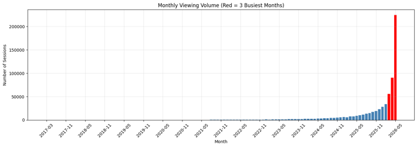

**Monthly Watch Hours Trend**

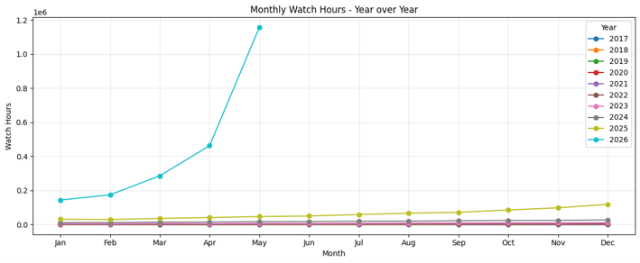

**Genre-wise Watch Hours Share**

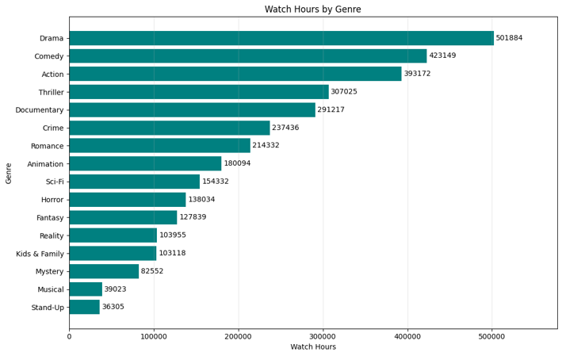

**Content Type Split**

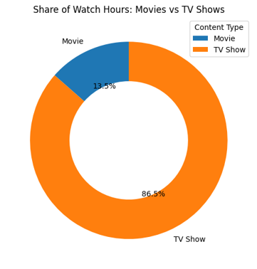

**Top Countries by Watch Hours**

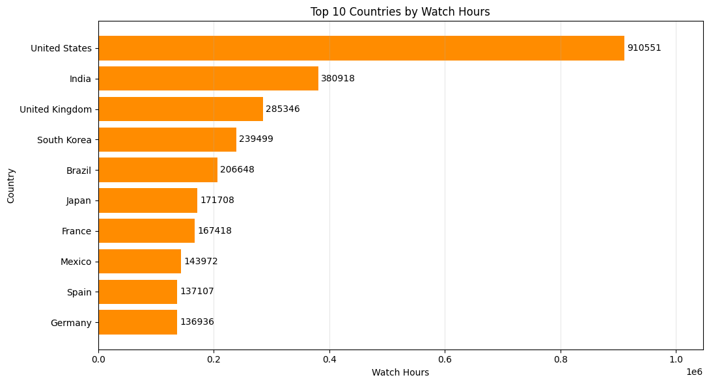

**Subscriber Plan Distribution**

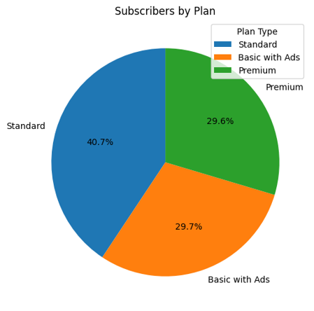

**Device Usage**

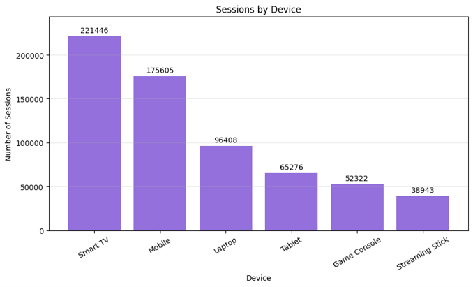

**Age Distribution**

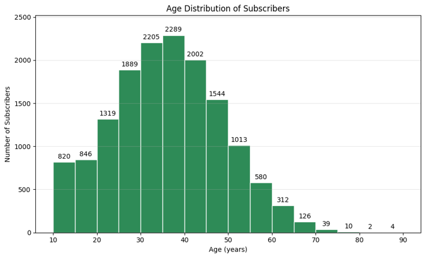

**Completion Rate by Genre**

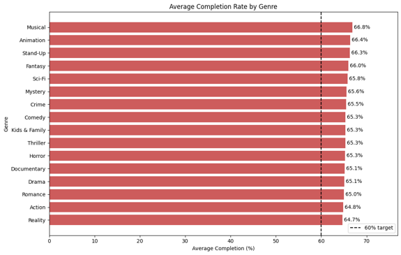

**Review Sentiment**

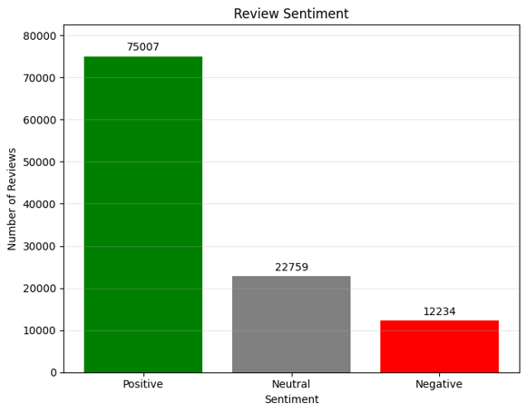

</details>

## 9. Key Performance Indicators

Report: [Phase 3 KPI Report](reports/StreamFlix_Phase3_KPI_Report_Bindiya_Anand.pdf)

| # | KPI | Definition | Result | Target | Status |
|---|-----|------------|--------|--------|--------|
| 1 | Total Watch Hours | Sum of `watch_duration_min` ÷ 60 | 2,274,135 hours | None | Informational |
| 2 | Active Rate | Active ÷ total subscribers | 74.66% (11,199 of 15,000) | > 70% | Met |
| 3 | Churn Rate | Inactive ÷ total subscribers | 25.34% (3,801 of 15,000) | < 30% | Met |
| 4 | Avg Completion Rate | Average of `completion_pct` | 65.33% | > 60% | Met |
| 5 | Monthly Recurring Revenue (MRR) | Sum of monthly price for active subscribers | $175,868.51 | None | Informational |
| 6 | ARPU | MRR ÷ active subscribers | $15.70 per month | None | Informational |
| 7 | Avg Watch Time / Subscriber | Total watch hours ÷ active subscribers | 203.07 hours | None | Informational |
| 8 | Watchlist Conversion | Watched entries ÷ total watchlist entries | 46.23% (30,048 of 65,000) | > 40% | Met |
| 9 | Hit Concentration | Share of plays from the top 10% of titles (900 of 9,000) | 31.10% | None | Informational |
| 10 | Originals Share of Hours | Hours on Originals ÷ total hours | 27.18% (618,153 hours) | None | Informational |

**Bonus: cohort retention**

Subscribers are grouped by signup month. A subscriber counts as retained at 3, 6, or 12 months if they stayed at least that long. Only subscribers who signed up at least that many months before the snapshot date (1 June 2026) are counted.

| Time after signup | Retained |
|-------------------|---------:|
| 3 months | 98.28% |
| 6 months | 95.72% |
| 12 months | 92.46% |

| Signup year | 3-month | 6-month | 12-month |
|-------------|--------:|--------:|---------:|
| 2016 | 99.16% | 97.89% | 96.62% |
| 2017 | 99.65% | 99.12% | 97.36% |
| 2018 | 99.28% | 98.44% | 96.29% |
| 2019 | 99.24% | 97.91% | 96.02% |
| 2020 | 99.11% | 97.78% | 95.33% |
| 2021 | 99.31% | 97.54% | 94.44% |
| 2022 | 98.73% | 96.95% | 93.72% |
| 2023 | 99.07% | 96.50% | 91.62% |
| 2024 | 98.53% | 95.26% | 89.10% |
| 2025 | 96.26% | 88.87% | 81.02% |
| 2026 | 89.88% | - | - |

**Notes on interpretation**

- **Churn Rate** counts all inactive subscribers out of all subscribers, as defined in the brief. It is not a monthly churn rate.
- **Retention** falls for newer cohorts: 12-month retention drops from 97.36% (2017 signups) to 81.02% (2025 signups).

## 10. Power BI Dashboard

File: `StreamFlix_Phase4_Dashboard_Bindiya_Anand` (Power BI Desktop report with 5 pages).

| Page | Visuals | Slicers |
|------|---------|---------|
| **1. Engagement Overview** | KPI cards (Total Subscribers 15K, Avg Completion Rate 65.3%, Total Watch Hours, Churn Rate 25.3%), Monthly Watch Hours Trend, Watch Hours Year-over-Year Comparison | Year, Plan Type |
| **2. Content Performance** | Watch Hours by Genre, Average Completion Rate by Genre, Top 10 Titles by Watch Hours | Year, Type, Language |
| **3. Subscriber Insights** | KPI cards (Active Subscribers 11K, ARPU $15.70, MRR $175.87K), Top 10 Countries by Watch Hours (map), Subscribers by Age Group and Plan, New Subscribers by Year, Subscribers by Plan (donut) | Plan Type, Region, Signup Year |
| **4. Experience** | KPI cards (Avg Rating 3.55, Review Count 110K, Positive Review % 68.2%), Sentiment Mix by Genre, Viewing Sessions by Device, Rating Distribution (1-5 stars), Review Sentiment | Plan Type, Primary Genre, Type |
| **5. Catalogue & Investment** | KPI cards (Titles Expiring in 12 Months 2K, Originals Share of Hours 27.2%, Watch Hours per $1K 0.16), Licences Expiring in the Next 12 Months (table), Licence Expiries by Month, Watch Hours per $1K Spend by Genre, Originals vs Licensed Watch Hours | Primary Genre, License Type, Type |

<details>
<summary><b>Dashboard screenshots</b></summary>

**Engagement Overview**
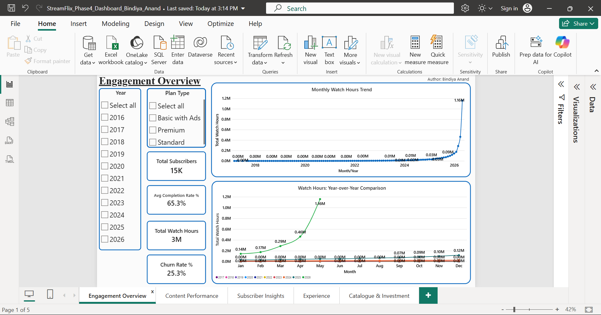

**Content Performance**
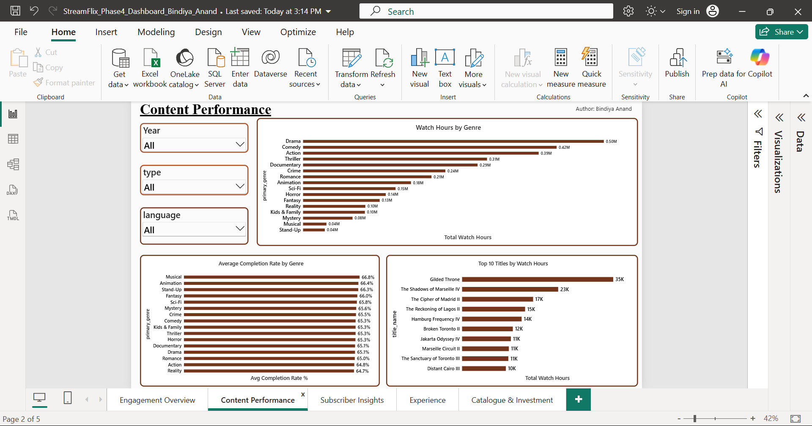

**Subscriber Insights**
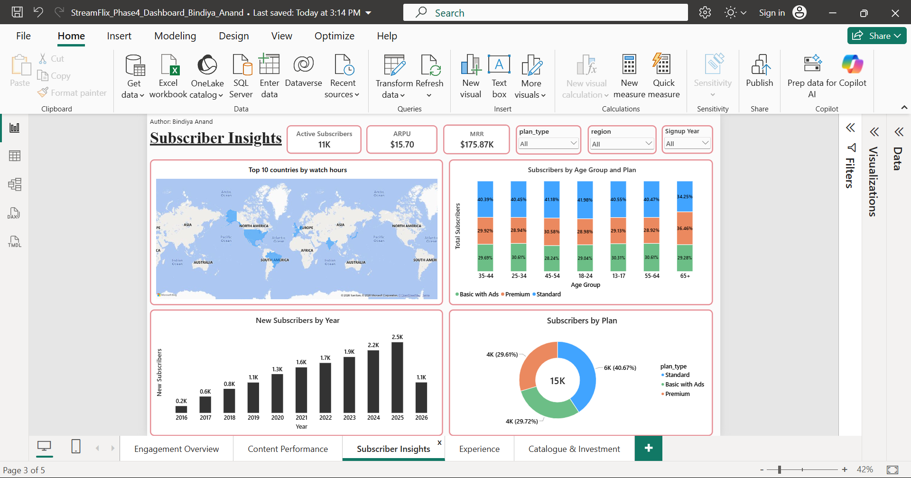

**Experience**
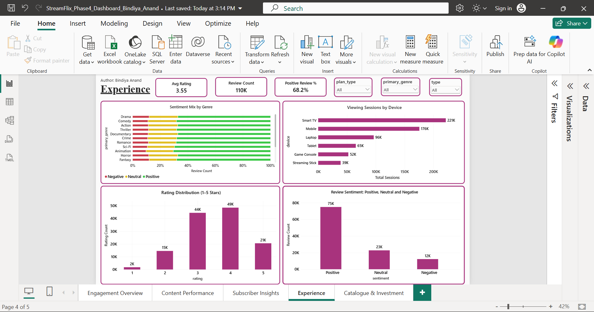

**Catalogue & Investment**
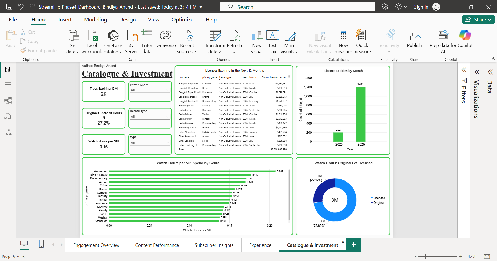

</details>

## 11. Key Findings

Report: [Phase 4 Management Report](reports/StreamFlix_Phase4_Management_Report_Bindiya_Anand.pdf)

1. **StreamFlix meets all its health targets.** 74.66% of subscribers are active, 25.34% have left, 65.33% of each title is watched on average, and 46.23% of watchlist titles are later watched. Standard is the biggest plan (about 41% of subscribers); Basic with Ads and Premium each hold about 30%.
2. **Drama, Comedy, and Action drive viewing, and TV Shows do most of the work.** Drama has 14.9% of watch time, Comedy 12.8%, Action 11.8%. TV Shows make up about 86.5% of viewing time. The top 10% of titles bring 31.10% of plays, and the most-watched title, Gilded Throne, has about 35,000 watch hours.
3. **Newer subscribers stay for a shorter time.** 12-month retention falls from 97.36% (2017 signups) to 81.02% (2025 signups). Of 2026 signups, only 89.88% remained after 3 months, against about 99% for earlier years.
4. **Licensed titles carry most of the viewing, and many licences expire soon.** Originals bring 27.18% of watch hours; the other 72.83% comes from licensed titles. About 2,000 titles are due to expire in the next 12 months, and 1,966 titles (21.84%) have no expiry date recorded.
5. **Catalogue spending returns about 0.16 watch hours per $1,000.** Animation (0.207), Kids & Family (0.177), Documentary (0.171), and Action (0.170) give the most return. Stand-Up (0.137), Musical (0.138), Sci-Fi (0.141), and Reality (0.142) give the least.
6. **Feedback is positive but mixed.** The average rating is 3.55 out of 5. 68.2% of the 110K reviews are positive, and about 12,000 (roughly 11%) are negative. 4 stars is the most common rating, followed by 3 stars.
7. **Revenue per subscriber is steady.** MRR is $175,868.51, or $15.70 per active subscriber per month.

## 12. Business Recommendations

These follow from the findings above; each needs the validation noted before action.

1. **Start a first-90-days programme for new subscribers.** Send a welcome guide, suggest titles based on taste, and remind them of saved titles. Track whether 3-month and 12-month retention improves for the 2026 group.
2. **Plan licence renewals now.** List titles expiring in the next 12 months, rank them by watch hours, and decide early which to renew. Fill in the missing expiry dates for the 1,966 titles without one.
3. **Review spending in low-return genres.** Check Stand-Up, Musical, Sci-Fi, and Reality before adding budget, and consider shifting more budget to Animation, Kids & Family, Documentary, and Action.
4. **Move more viewers from saved titles to watching.** Use reminders and home-screen picks to lift watchlist conversion above 46%, and promote titles outside the top few hits to spread viewing more widely.
5. **Confirm viewing records for earlier years.** Before reporting any growth in viewing to the board, check that all years are fully recorded.
6. **Focus on the biggest markets and screens.** Prioritise the United States, India, and the United Kingdom, and keep playback smooth on Smart TVs and Mobile.
7. **Reach the right age groups.** Subscribers aged 35-44 are the largest group and watch the most in total; those aged 45-54 watch the most per person.

## 13. Repository Structure

```
StreamFlix-Content-Analytics/
├── README.md
├── images/
│   ├── dashboard/
│   │   ├── 01_engagement_overview.png
│   │   ├── 02_content_performance.png
│   │   ├── 03_subscriber_insights.png
│   │   ├── 04_experience.png
│   │   └── 05_catalogue_investment.png
│   └── plots/
│       ├── 01_monthly_viewing_volume.png
│       ├── 02_monthly_watch_hours_trend.png
│       ├── 03_genre_wise_watch_hours_share.png
│       ├── 04_content_type_split.png
│       ├── 05_top_countries_watch_hours.png
│       ├── 06_subscriber_plan_distribution.png
│       ├── 07_device_usage.png
│       ├── 08_age_distribution.png
│       ├── 09_completion_rate.png
│       └── 10_review_sentiment.png
├── notebooks/
│   ├── StreamFlix_Phase1_DataCleaning_Bindiya_Anand.ipynb
│   ├── StreamFlix_Phase2_EDA_Bindiya_Anand.ipynb
│   └── StreamFlix_Phase3_KPI_Bindiya_Anand.ipynb
├── power_bi_dashboard/
│   └── StreamFlix_Phase4_Dashboard_Bindiya_Anand.pbit
└── reports/
    ├── StreamFlix_Phase1_Data_Quality_Report_Bindiya_Anand.pdf
    ├── StreamFlix_Phase2_EDA_Report_Bindiya_Anand.pdf
    ├── StreamFlix_Phase3_KPI_Report_Bindiya_Anand.pdf
    └── StreamFlix_Phase4_Management_Report_Bindiya_Anand.pdf
```

## 14. Viewing the Power BI Dashboard

- **Quick view:** see the dashboard overview video above or the screenshots in [Section 10](#10-power-bi-dashboard) or open the images in `images/dashboard/`.
- **Interactive view:** download the Power BI dashboard file from (power_bi_dashboard/StreamFlix_Phase4_dashboard_Bindiya_Anand.pbit) and view in the Microsoft Power BI desktop free install.

## 15. Limitations and Future Improvements

**Limitations**

- **Row counts differ across phases.** Phase 1 profiled `watch_history` at 650,000 rows, while Phase 3 KPIs used 443,786 rows. Session counts in Phase 2 (for example Smart TV 46,199) are also lower than the dashboard (Smart TV 221K). These should be reconciled before the figures are compared directly.
- **Uneven viewing data over time.** Almost all recorded viewing is from 2025 and 2026, with a large jump in the latest months. This should not be called growth until earlier years are confirmed as fully recorded.
- **Positive review share differs slightly by source.** The EDA chart shows 68.6%; the dashboard and management report show 68.2% of 110K reviews.
- **Missing licence expiry dates.** 21.84% of titles have no `license_expiry`, so the true number of expiring titles may differ from the 2,000 reported.
- **Churn Rate is cumulative.** It counts all inactive subscribers out of all subscribers, not churn per month.
- **No profit or cost-to-serve data** was analysed; spending return is measured in watch hours per $1,000 only.

**Potential improvements**

- Reconcile `watch_history` row counts across phases and rerun the KPIs on the full file.
- Confirm full recording for 2016-2024 before reporting viewing growth.
- Calculate monthly churn rate alongside the cumulative churn rate.
- Add title-level licence renewal ranking by watch hours.
- Predictive churn modelling for new subscribers.

## 16. Skills Demonstrated

- **Data cleaning:** type conversion, missing-value and duplicate profiling, outlier checks, referential-integrity validation
- **EDA:** time-series, distribution, and segment analysis with Matplotlib
- **Business metrics:** KPI definition, target comparison, cohort retention, critical interpretation (uneven data coverage, metric definitions)
- **Dashboarding:** multi-page Power BI report with slicers and KPI cards
- **Communication:** translating analysis into business findings and recommendations for management

## 17. Author

**Bindiya Anand**
Data Analyst Intern

- GitHub: https://github.com/Bindiya-Anand
- LinkedIn: https://www.linkedin.com/in/bindiya-anand/
